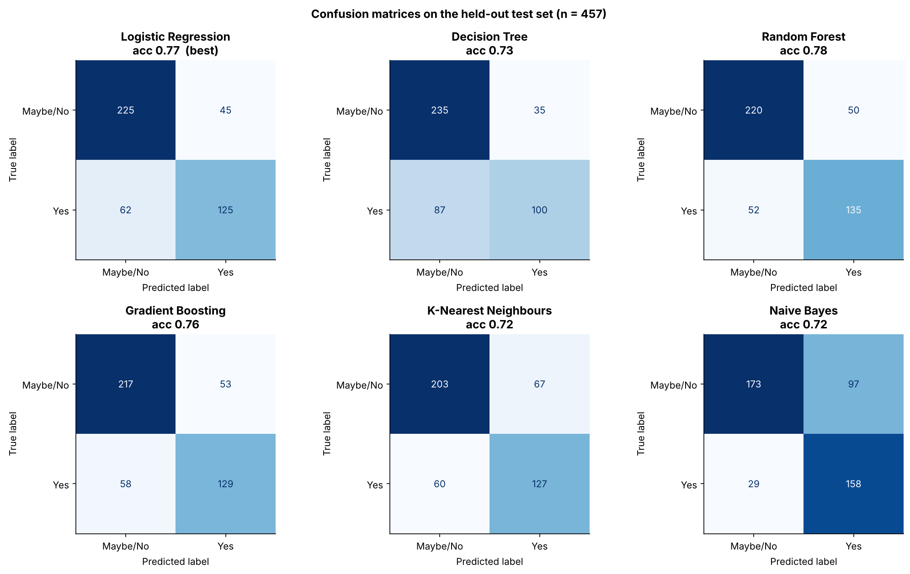
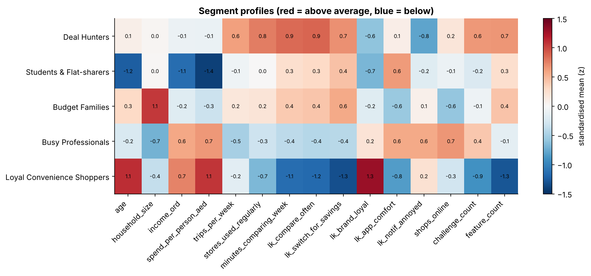
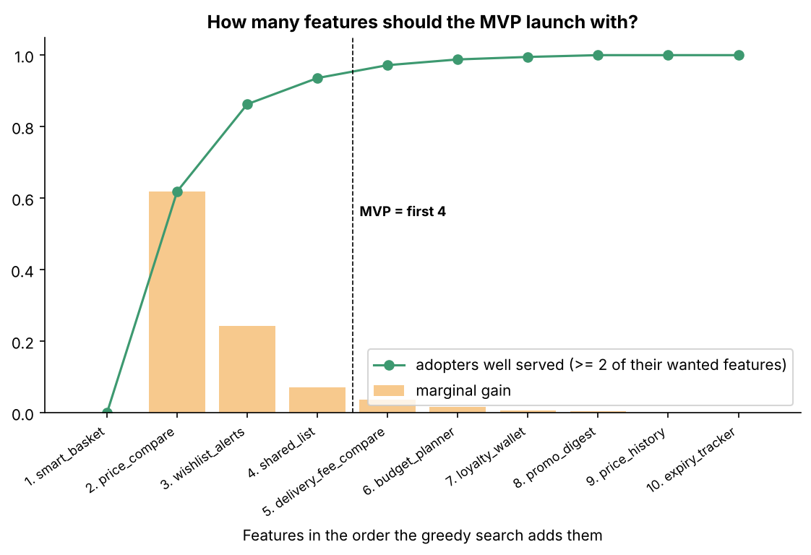
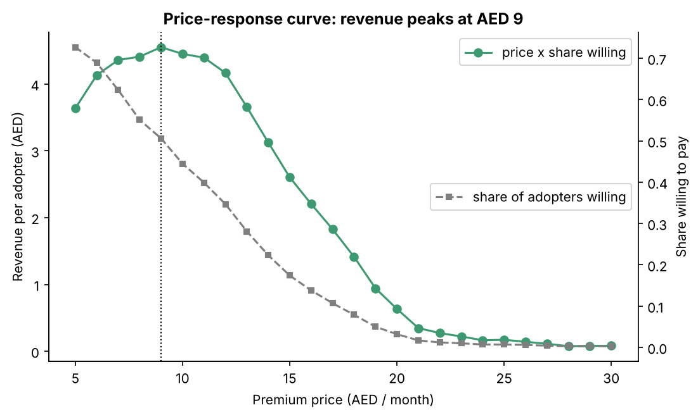

# BasketWise UAE — Business Idea Validation with Data Analytics

Validating a grocery price-comparison app for UAE households using a 25-question survey, a synthetic dataset of 2,000 respondents with deliberate noise, and four machine-learning techniques: **classification, clustering, association rule mining and regression**.

> **BasketWise** tells you which store is cheapest for your *whole* grocery basket, including delivery fees, and only notifies you when items on your own list genuinely drop in price.

🚀 **Live dashboard:** *add your Streamlit link here after deploying* · 📄 **Full report:** [`REPORT.md`](REPORT.md) · 📝 **Survey:** [`survey/survey_questionnaire.md`](survey/survey_questionnaire.md) · 🗺️ **Column-to-algorithm map:** [`docs/column_algorithm_map.md`](docs/column_algorithm_map.md)

---

## Key results

| Step | Question | Result | Decision |
|---|---|---|---|
| Data engineering | Is the data usable? | 2,040 raw rows → **1,825** valid (duplicates, speeders, straight-liners, contradictions removed; outliers capped; missing imputed) | Same cleaning script runs on the real survey export |
| Descriptive | Is the problem real? | Median spend AED 2,350/mo, 26 min/week spent comparing, 47% want *only* big-saving alerts | "Quiet savings" positioning |
| Classification | Who will adopt? | Logistic Regression, **AUC 0.85**, accuracy 77% vs 59% baseline | High lead tier converts at **82%** → paid acquisition targets only them |
| Clustering | What shopper types exist? | **5 segments** (K-Means), recovering hidden personas at ARI 0.75 | Launch with Deal Hunters (77% adoption); ignore Loyal Shoppers (2%) |
| Association rules | Which features go together? | price compare + price history → wishlist alerts (**90%** confidence, lift 1.53) | **4-feature MVP** serves 94% of adopters |
| Regression | What will people pay? | Random Forest, **R² 0.44**, MAE AED 3.0 vs 4.7 baseline | Premium at **AED 9/month**; delivery-fee compare goes behind the paywall |
| Business case | Is it sustainable? | Base case still loses AED 0.9M in Year 3; breaks even at ~AED 1.0 partner revenue per active user/month | Pilot with kill criteria on acquisition cost and retailer partnerships |

> The data is **synthetic**: the relationships were designed in, so the project validates the *method*, not real demand. See [Limitations](REPORT.md#10-limitations).

## Interactive dashboard

`streamlit_app.py` turns the analysis into a 9-page web app:

| Page | What you can do |
|---|---|
| Overview | Headline results, the full question → finding → decision chain, segment map |
| Data & cleaning | See every injected data problem and cleaning rule; filter and download raw or clean data |
| Descriptive analytics | Break adoption down by income, age, channel, emirate…; compare pains and features of adopters vs others |
| Classification | Switch between 6 models and move the decision threshold — the **confusion matrix** and metrics update live |
| Clustering | Change k and watch segments, silhouette and profiles change |
| Association rules | Adjust support / confidence / lift, filter by rule family or item, mine adopters only |
| Regression & pricing | Compare WTP models; pick a price and audience to see share willing and revenue |
| Business case | Change every assumption (downloads, conversion, CAC, partner revenue) and see the 3-year P&L |
| Customer simulator | Describe a shopper → adoption probability, predicted willingness to pay, segment and recommended action |

Run it locally:

```bash
streamlit run streamlit_app.py
```

## Repository structure

```
basketwise-uae-analytics/
├── README.md                     ← you are here
├── REPORT.md                     ← full business strategy & analytics report
├── streamlit_app.py              ← interactive dashboard (Streamlit)
├── run_pipeline.py               ← runs every step end to end
├── requirements.txt
├── .streamlit/config.toml        ← dashboard theme
├── survey/
│   └── survey_questionnaire.md   ← 25 questions, each mapped to a column & algorithm
├── docs/
│   ├── column_algorithm_map.md   ← which column feeds which algorithm, and why
│   └── data_dictionary.md        ← every column, file and injected data problem
├── src/
│   ├── config.py                 ← paths, column groups, category orders
│   ├── utils.py                  ← plotting / saving helpers
│   ├── generate_data.py          ← step 0: synthetic survey with noise & outliers
│   ├── clean_transform.py        ← step 1: data engineering
│   ├── descriptive.py            ← step 2: descriptive analytics
│   ├── classification.py         ← step 3: 6 classifiers, confusion matrices, lead scoring
│   ├── clustering.py             ← step 4: K-Means vs Ward, k selection, segment profiles
│   ├── association.py            ← step 5: Apriori rules, MVP sizing
│   ├── regression.py             ← step 6: 5 regressors, WTP drivers, pricing curve
│   └── business_case.py          ← step 7: 3-year scenarios & sensitivity
├── data/
│   ├── raw/                      ← messy survey export, hidden answer key, noise log
│   └── processed/                ← clean data, model-ready data, segments
└── outputs/
    ├── figures/                  ← 20 charts (PNG)
    ├── tables/                   ← 30+ result tables (CSV)
    └── results_summary.json      ← every headline number in one file
```

## How to run

Requires **Python 3.9+**.

```bash
# 1. Get the code
git clone https://github.com/<your-username>/basketwise-uae-analytics.git
cd basketwise-uae-analytics

# 2. (Recommended) create a virtual environment
python -m venv .venv
source .venv/bin/activate          # Windows: .venv\Scripts\activate

# 3. Install packages
pip install -r requirements.txt

# 4. Run everything (≈ 1 minute)
python run_pipeline.py
```

Options:

```bash
python run_pipeline.py --regenerate      # rebuild the synthetic dataset from scratch first
python src/classification.py             # run a single step (after cleaning has run once)
```

All outputs are regenerated in `outputs/`. Random seed is fixed at 42, so results are identical on every machine.

## Put it on GitHub (no command line needed)

1. Sign in at [github.com](https://github.com) and click **+ → New repository**.
2. Name it `basketwise-uae-analytics`, choose **Public** (simplest for Streamlit and for sharing with your instructor), and leave "Add a README" **unticked**. Click **Create repository**.
3. On the empty repository page click **uploading an existing file**.
4. Unzip the project on your computer, open the `basketwise-uae-analytics` folder, select **everything inside it** and drag it onto the upload page. GitHub keeps the folder structure.
   - On a Mac, press **Cmd + Shift + .** in Finder first so the hidden `.streamlit` folder and `.gitignore` are selected too. (The app still works without them; they only set the theme.)
5. Write a commit message such as "Initial commit" and click **Commit changes**.

Or with Git:

```bash
cd basketwise-uae-analytics
git init && git add . && git commit -m "Initial commit"
git branch -M main
git remote add origin https://github.com/<your-username>/basketwise-uae-analytics.git
git push -u origin main
```

## Deploy on Streamlit Community Cloud (free)

1. Go to [share.streamlit.io](https://share.streamlit.io) and **sign in with GitHub**, allowing Streamlit to access your repositories.
2. Click **Create app** (top right), then **Yup, I have an app**.
3. Fill in: **Repository** `<your-username>/basketwise-uae-analytics` · **Branch** `main` · **Main file path** `streamlit_app.py`.
   (Or click **Paste GitHub URL** and paste the link to `streamlit_app.py` in your repository.)
4. Optionally set a custom **App URL**, e.g. `basketwise-uae.streamlit.app`. The default Python version (3.12) works; no secrets are needed.
5. Click **Deploy**. The first build installs `requirements.txt` and usually takes a few minutes. The first page load then trains the models (about 10 seconds); after that pages are instant.
6. Paste the app's URL into the "Live dashboard" line at the top of this README.

Every later commit to `main` redeploys the app automatically.

**If the build fails,** open the app's logs (shown on the right-hand side of the app page for the repository owner). The usual causes are a missing folder (check `src/` and `data/` were uploaded) or a wrong main file path.

## Using real survey data
Export your survey with the column names in [`docs/data_dictionary.md`](docs/data_dictionary.md), save it as `data/raw/basketwise_survey_raw.csv`, and run `python run_pipeline.py` without `--regenerate`. The persona validation step is skipped automatically when no answer key is present.

## Methods at a glance

| Technique | Inputs | Algorithms compared | Evaluation |
|---|---|---|---|
| Classification | 57 pre-pitch features (demographics, behaviour, attitudes, challenges, features) | Logistic Regression, Decision Tree, Random Forest, Gradient Boosting, KNN, Naive Bayes (+ 3-class model) | 5-fold CV AUC, test accuracy, precision, recall, F1, ROC, **confusion matrix** |
| Clustering | 15 behaviour & attitude variables (standardised) | K-Means (k = 2–9), Agglomerative Ward | Elbow, silhouette, Davies-Bouldin, Calinski-Harabasz, ARI |
| Association rules | 7 challenge + 10 feature tick-boxes only | Apriori + redundancy pruning | Support, confidence, lift, leverage, conviction |
| Regression | Same as classification | OLS, Ridge, Lasso, Random Forest, Gradient Boosting | 5-fold CV R², test R², MAE, RMSE vs mean baseline |

## Sample figures

| | |
|---|---|
|  |  |
|  |  |

## Acknowledgements

Retailer names (Carrefour, Lulu, Union Coop, Spinneys, Choithrams) appear only to describe where prices would be compared. This is an academic project with no affiliation to any of them. Built with pandas, scikit-learn, mlxtend and matplotlib.

## License

[MIT](LICENSE)
