# BasketWise UAE — Validating a Business Idea with Data Analytics

**Individual assignment · Data analytics for business strategy**
**Idea:** a grocery price-comparison app for UAE households
**Data:** synthetic survey of 2,000 respondents (25 questions), deliberately noisy
**Techniques:** data engineering, descriptive analytics, classification, clustering, association rule mining, regression, scenario modelling

> **Read this first.** The data is synthetic. I designed the hidden customer types and the relationships in it, so the algorithms find patterns because they were put there. What this project proves is that the *method* works end to end — the survey, the cleaning, the models, the accuracy checks and the decisions — so that the same code can be run on a real survey export. It does not prove real demand. Every figure in this report is reproduced by `python run_pipeline.py`.

---

## 1. The business idea

### 1.1 Problem
Grocery is one of the largest recurring household costs in the UAE, and the same basket can cost noticeably different amounts at Carrefour, Lulu, Union Coop, Spinneys, Choithrams and the quick-commerce apps. Shoppers who want the best price have to check flyers and several apps, while being flooded with promotional notifications that rarely match what they actually need.

### 1.2 Proposed solution
**BasketWise** compares grocery prices across stores and delivery apps and answers one question: *"Where is my whole basket cheapest this week, including delivery fees?"* Its positioning is **quiet savings** — it only notifies you when something on your own list genuinely drops in price, instead of pushing every promotion.

This idea follows the same pattern as the reference project (a console-game price tracker with quiet wishlist alerts), moved to a market with more frequent purchases and a much larger audience: every household buys groceries every week.

### 1.3 What we need to decide before building
| Business question | Function | Technique |
|---|---|---|
| Who is the customer, and do they actually feel the problem? | Marketing | Descriptive analytics |
| Will a given person adopt the app? Whom should we spend acquisition money on? | Marketing | **Classification** |
| What distinct types of shoppers exist, and what does each need? | Marketing / Product | **Clustering** |
| Which features must the first version include, and which ones go together? | Product / Operations | **Association rule mining** |
| What will people pay for Premium, and what drives it? | Finance | **Regression** |
| Is the business sustainable, and under what conditions? | Finance | Scenario & sensitivity model |

---

## 2. Data

### 2.1 Survey design
The 25-question survey (`survey/survey_questionnaire.md`) is within the 20–25 question limit and includes demographics. Every question was written with a specific algorithm in mind:

- **Q25** "Would you download and use BasketWise?" (Yes / Maybe / No) is the **classification target**.
- **Q15** (7 challenges) and **Q16** (10 features) are **tick-all-that-apply**, which is what association rule mining needs.
- **Q20** "Most you would pay per month for Premium (AED)" is the **regression target**.
- Behaviour and attitude questions (Q8–Q14) are the main **clustering** inputs.
- An attention-check row and completion time support data-quality filtering.

The full column-to-algorithm map is in `docs/column_algorithm_map.md`.

### 2.2 Synthetic data generation
`src/generate_data.py` simulates 2,000 respondents. Each is secretly assigned to one of five personas (Budget Families, Busy Professionals, Students & Flat-sharers, Loyal Convenience Shoppers, Deal Hunters). Answers follow from the persona plus individual randomness, and there are built-in dependencies — for example, people who face hidden delivery fees are more likely to want delivery-fee comparison. Adoption intent comes from a single latent score with two cut-points, which produces a realistic mix: **41% Yes, 30% Maybe, 29% No**.

### 2.3 Deliberate noise
Real survey exports are messy, so 1,052 problems were injected and logged in `data/raw/noise_injection_log.csv`:

| Problem | Count |
|---|---|
| Missing values (7 columns) | 360 cells |
| Inconsistent spellings / formats (emirate, gender, income) | 320 |
| Randomly flipped Q25 answers (undetectable) | 100 |
| Speeders and straight-liners | 60 + 60 |
| Extreme outliers (spend ×3–5, 600+ min/week, WTP AED 150–500) | 40 |
| Contradictory answers | 40 |
| Impossible values (age 999, spend −250, household 0) | 32 |
| Duplicates (exact and under a new ID) | 25 + 15 |

The 100 flipped labels are there on purpose. They cannot be detected, so no model can be perfect — just as in a real survey, where some people answer carelessly.

---

## 3. Data engineering

`src/clean_transform.py` applies 15 rules in a fixed order and logs each one (`outputs/tables/cleaning_log.csv`). **2,040 raw rows became 1,825 valid respondents.**

| Step | Rule | Rows affected |
|---|---|---|
| Remove duplicates | Exact copies, then identical answers under a new ID | 25 + 15 |
| Standardise text | `DXB` → Dubai, `M` → Male, `AED 10k-20k` → 10,000–19,999 | 160 / 100 / 56 |
| Remove speeders | Under 120 seconds for 25 questions | 60 |
| Remove failed attention checks | Instructed row not answered "Agree" (catches straight-liners) | 76 |
| Remove contradictions | Says "No" to the app, but picks Premium and WTP ≥ AED 20 | 39 |
| Impossible → missing | Age outside 16–80, household 0, spend ≤ AED 100 or > 50,000 | 14 / 7 / 10 |
| Cap extreme values | Above Q3 + 3×IQR for spend, minutes, WTP | 16 / 43 / 10 |
| Impute missing | Median (spend by household size, age by occupation), mode for categories | 317 cells |

**Why cap instead of delete outliers?** A family of seven really can spend AED 12,000 a month on groceries. Capping keeps the person but stops one value from dominating means and linear models. Values that cannot be true (negative spend, age 999) are treated as entry errors instead.

**Why leave the WTP target missing?** Imputing a target invents an answer. Those 39 rows are simply skipped in the regression.

**Feature engineering.** 13 new columns were added, including `spend_per_person_aed`, `spend_share_of_income`, `price_seeker_index` (compare + switch + reversed brand loyalty), `challenge_count`, `feature_count` and the binary target `is_adopter`. Nominal categories were one-hot encoded with one level dropped to avoid the dummy-variable trap.

---

## 4. Descriptive analytics — knowing the customer

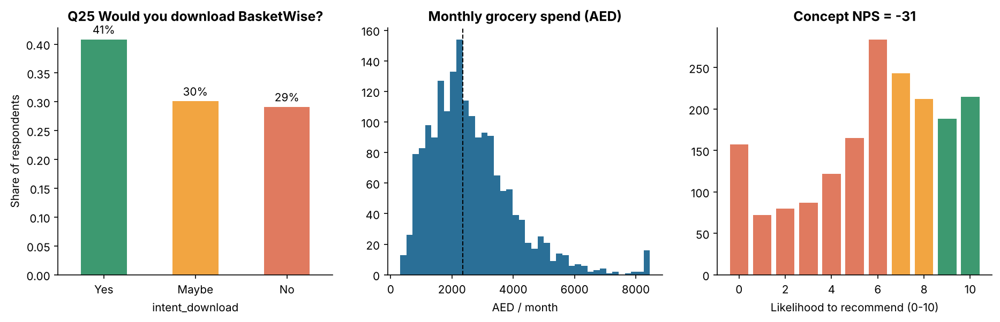

- **Intent:** 40.8% would download (Yes), 30.1% Maybe, 29.1% No.
- **The problem is real for most people:** median household spend is **AED 2,350/month**, 51% regularly use three or more stores, and the median shopper spends **26 minutes a week** comparing prices.
- **Top pain points:** too many promotional notifications (56%), comparing takes too long (53%), and price inconsistency between stores (51%).
- **The quiet-alerts positioning is supported:** 47% want to be notified *only* about big savings on their own list, against 10% who want real-time alerts for every deal.
- **Concept NPS is −31.** That looks bad, but it is an average of two very different groups: Deal Hunters score +35, while Loyal Convenience Shoppers score −100. This is exactly why segmentation matters.

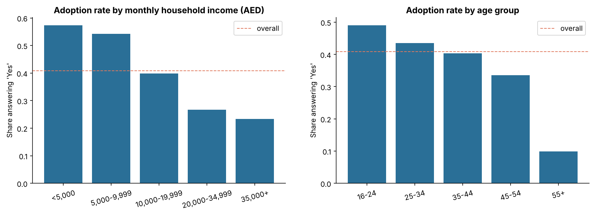

Adoption falls steadily with income, from 57% in households earning under AED 5,000 to 23% above AED 35,000. Lower-income households have the strongest reason to compare, but (as the regression shows) they also pay the least.

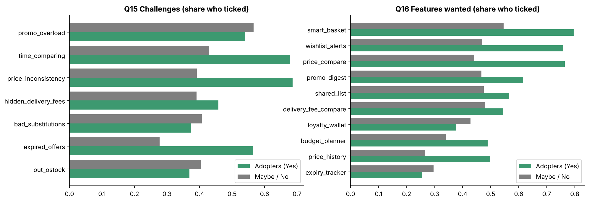

Adopters tick far more of the price-related items than non-adopters: expired offers (2.0× as often), price history (1.9×), price inconsistency (1.75×) and single-product price comparison (1.7×). Loyalty wallets and expiry trackers are wanted slightly *less* by adopters, so they are not reasons to download a price app.

**Note on emirate:** adoption varies only between 33% and 46% across emirates, and the smaller emirates have small samples. In this synthetic data, emirate was generated independently of intent, so no conclusion should be drawn from it.

---

## 5. Classification — who will adopt?

**Why classification?** The marketing question is yes/no: will this person download the app? Classification learns that from the survey and can then score any new lead, so acquisition spend goes to people most likely to convert.

**Setup.** Target `is_adopter` (Q25 = Yes, 40.8% positive). 57 input columns from demographics, behaviour, attitudes, challenges and features. Answers given after the concept was pitched (NPS, WTP, preferred plan, platform, alert preference, expected saving) were **excluded to avoid leakage**: they are given at the same moment as Q25, so they partly restate it and would not be known for a new lead. Data split 75/25, stratified.

### 5.1 Model comparison

| Model | CV AUC (5-fold) | Test accuracy | Precision | Recall | F1 | Test AUC |
|---|---|---|---|---|---|---|
| **Logistic Regression** | **0.846 ± 0.012** | 0.766 | 0.735 | 0.668 | 0.700 | 0.851 |
| Random Forest | 0.844 ± 0.015 | 0.777 | 0.730 | 0.722 | 0.726 | 0.852 |
| Gradient Boosting | 0.834 ± 0.019 | 0.757 | 0.709 | 0.690 | 0.699 | 0.842 |
| Naive Bayes | 0.830 ± 0.012 | 0.724 | 0.620 | 0.845 | 0.715 | 0.832 |
| K-Nearest Neighbours | 0.812 ± 0.019 | 0.722 | 0.655 | 0.679 | 0.667 | 0.815 |
| Decision Tree | 0.809 ± 0.019 | 0.733 | 0.741 | 0.535 | 0.621 | 0.810 |
| *Baseline: always predict "not adopter"* | — | *0.591* | — | — | — | *0.500* |

**Why Logistic Regression and not Random Forest, which has slightly higher test accuracy?** The model was chosen on cross-validated AUC from the training data only. Choosing by test score would let the test set influence the decision and overstate performance. The two are within noise of each other, and Logistic Regression is simpler, faster and explainable to a marketing team.

### 5.2 Confusion matrix

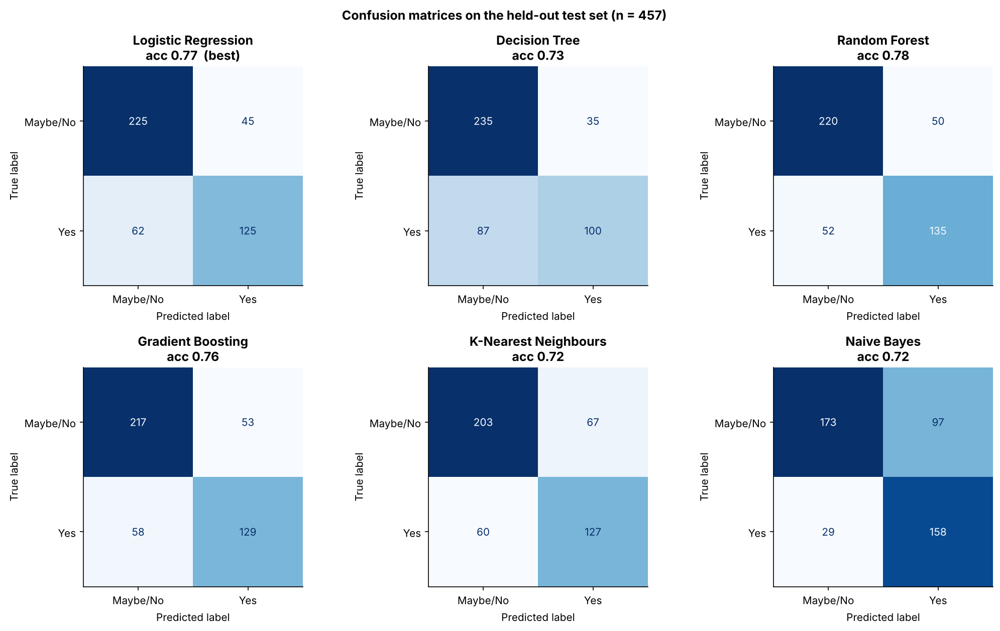

For the chosen model on 457 test respondents: **125 true positives, 225 true negatives, 45 false positives, 62 false negatives.** Accuracy is 77% against a 59% baseline. The model misses about a third of real adopters, which is acceptable for prioritising spend, but it should not be used to exclude anyone from organic channels. Naive Bayes shows the trade-off clearly: it catches 85% of adopters but wrongly flags 97 non-adopters.

The **3-class model** (No / Maybe / Yes) reaches 65% accuracy against a 41% baseline. Most of its errors are between neighbouring classes ("Maybe" vs "Yes"), as expected for an ordinal answer.

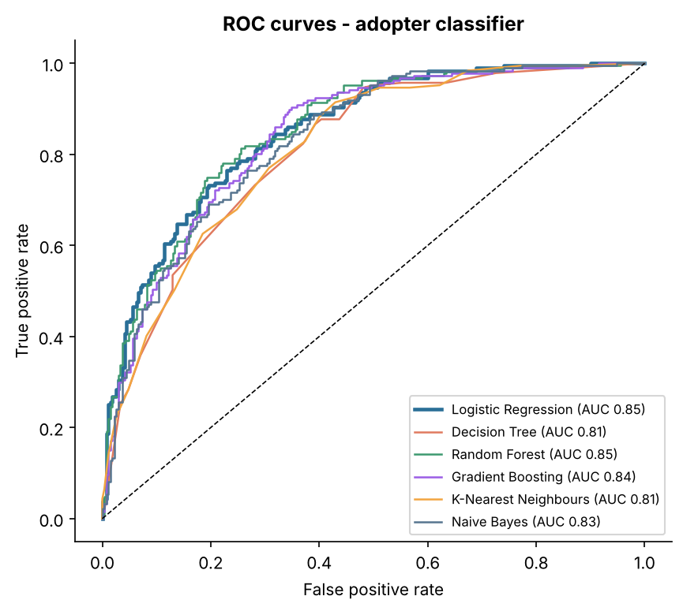

### 5.3 What drives adoption

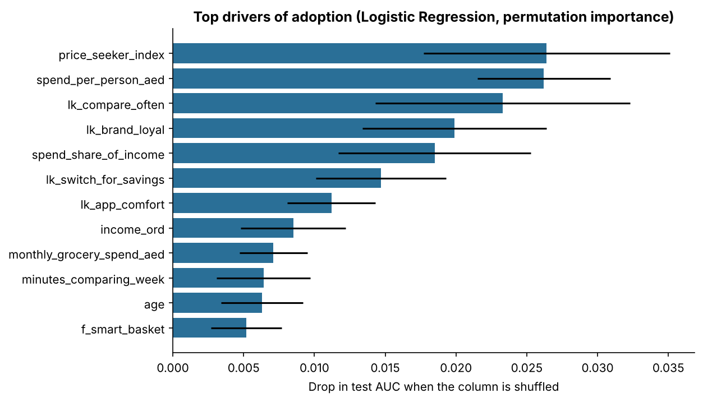

The strongest drivers are attitudes, not demographics: the price-seeker index, spend per person, how often people already compare, brand loyalty (negative), spend as a share of income, willingness to switch for 5% savings and comfort with apps.

### 5.4 Decision: lead scoring

| Lead tier (predicted probability) | Share of people | Actual "Yes" rate |
|---|---|---|
| High (> 0.65) | 27% | **82%** |
| Medium (0.35–0.65) | 25% | 50% |
| Low (< 0.35) | 48% | 12% |

**Decision:** paid acquisition targets High-tier profiles only. Medium-tier people get low-cost nurturing (referral links, content about weekly basket savings). Low-tier people are not targeted with paid media. That concentrates spend on the quarter of the market that converts at 82%.

---

## 6. Clustering — what kinds of shoppers exist?

**Why clustering?** One message cannot work for a student sharing a flat and a high-income family loyal to one store. Clustering finds natural groups *without* using the adoption answer, so we can then check whether the groups differ commercially.

**Setup.** 15 behavioural and attitude inputs (age, household size, income, spend per person, trips, stores used, minutes comparing, the five attitude statements, online shopping, challenge and feature counts). Skewed variables were log-transformed and all were standardised. Adoption, NPS and WTP were kept aside to describe segments afterwards.

### 6.1 Choosing the number of clusters

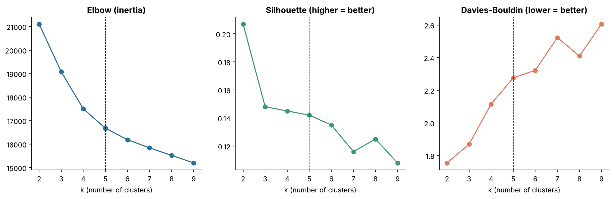

Silhouette scores are low for every k (0.11–0.21), which is normal for survey attitudes: people sit on a continuum rather than in tight balls. k = 2 scores highest but only splits "price-driven" from "not", which is too coarse to act on. The elbow is not sharp. The final choice used a transparent rule combining statistics and business needs:

1. k ≥ 3 (actionable detail), and k ≤ 6 (a small team cannot run more campaigns),
2. silhouette within 0.01 of the best k in that range,
3. every segment at least 12% of respondents.

k = 3, 4 and 5 pass; **k = 5** was chosen as the most detailed option that still passes. Agglomerative (Ward) clustering with k = 5 agrees with K-Means at ARI 0.61, so the structure is not an artefact of one algorithm.

**Validation (possible only because the data is synthetic):** the five clusters recover the hidden personas with an Adjusted Rand Index of **0.745**, and 88% of respondents land in the segment matching their true persona. The main confusion is that some Budget Families who compare a lot are grouped with Deal Hunters, which is a reasonable mistake.

### 6.2 The five segments

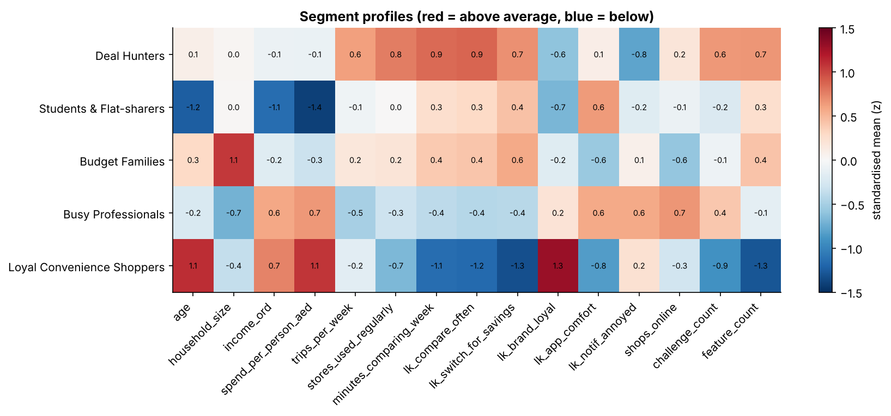

| Segment | Share | Adoption | Avg WTP (AED/mo) | Concept NPS | What they want | Main pain |
|---|---|---|---|---|---|---|
| **Deal Hunters** | 20% | **77%** | 9.4 | +35 | price compare, wishlist alerts, smart basket | price inconsistency, time |
| **Students & Flat-sharers** | 19% | 53% | 2.2 | −11 | budget planner, price compare, shared list | price inconsistency, time |
| **Budget Families** | 20% | 51% | 7.0 | −16 | smart basket, price compare, shared list | time, price inconsistency |
| **Busy Professionals** | 23% | 22% | 9.1 | −62 | delivery-fee compare, smart basket, alerts | notification overload, delivery fees |
| **Loyal Convenience Shoppers** | 18% | 2% | 1.8 | −100 | loyalty wallet | out of stock |

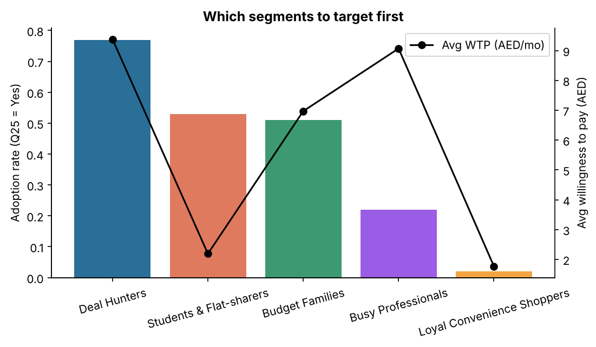

### 6.3 Decisions
- **Launch segment: Deal Hunters.** Highest adoption, highest WTP and the only positive NPS. They will also seed reviews and referrals.
- **Volume segments: Budget Families and Students.** About half adopt. Families pay moderately; students barely pay, so they are monetised through ads and partner offers rather than Premium. The shared list feature serves both.
- **Upsell segment: Busy Professionals.** Few adopt today, but those who do pay as much as Deal Hunters. They care about delivery fees, not shelf prices, so they need a different message ("see the true total across delivery apps") and are a Phase 2 target.
- **Do not target Loyal Convenience Shoppers.** 2% adoption. Spending money on them is waste.

---

## 7. Association rule mining — what goes together?

**Why association rules?** We cannot build ten features at launch. Rules tell us which pains travel together and which features users expect *together*, so we do not launch A and B while users who want A and B also expect C.

**Setup.** Only the 17 tick-box items (7 challenges, 10 features). Age, spend and Likert scores are not "items" and are excluded. Apriori with minimum support 8%, confidence ≥ 60% and lift > 1.1. Rules were then **pruned**: a rule is dropped if a simpler rule with the same consequent reaches nearly the same confidence (within 3 points), because the extra items add nothing a manager can act on. That left 307 rules from 1,307 frequent itemsets.

### 7.1 Challenges that occur together

| If a shopper faces… | …they also face | Support | Confidence | Lift |
|---|---|---|---|---|
| expired offers + price inconsistency | time spent comparing | 20% | **81%** | 1.52 |
| expired offers + time comparing | price inconsistency | 20% | 75% | 1.47 |
| bad substitutions + time comparing | hidden delivery fees | 15% | 71% | 1.69 |
| bad substitutions | hidden delivery fees | 26% | 65% | 1.56 |

There are two distinct pain clusters: a **shelf-price cluster** (inconsistent prices, expired offers, time wasted) and an **online-delivery cluster** (hidden fees, bad substitutions). These match the Deal Hunter / Family and Busy Professional segments.

### 7.2 From pain to feature

| Challenge(s) | Feature wanted | Confidence | Lift |
|---|---|---|---|
| hidden delivery fees | delivery-fee comparison | 78% | 1.54 |
| expired offers + price inconsistency | wishlist alerts | 83% | 1.41 |
| expired offers + price inconsistency | single-product price comparison | 78% | 1.36 |
| expired offers | wishlist alerts | 77% | 1.31 |

### 7.3 Features that must ship together

| If users want… | …they also want | Confidence | Lift |
|---|---|---|---|
| price compare + price history | wishlist alerts | **90%** | 1.53 |
| price history | wishlist alerts | 79% | 1.35 |
| price history + wishlist alerts | price compare | 77% | 1.35 |
| price compare + price history | smart basket | 78% | 1.21 |

**Price history is never wanted on its own.** Nine in ten people who want price compare and price history also want wishlist alerts, so those features should be released together.

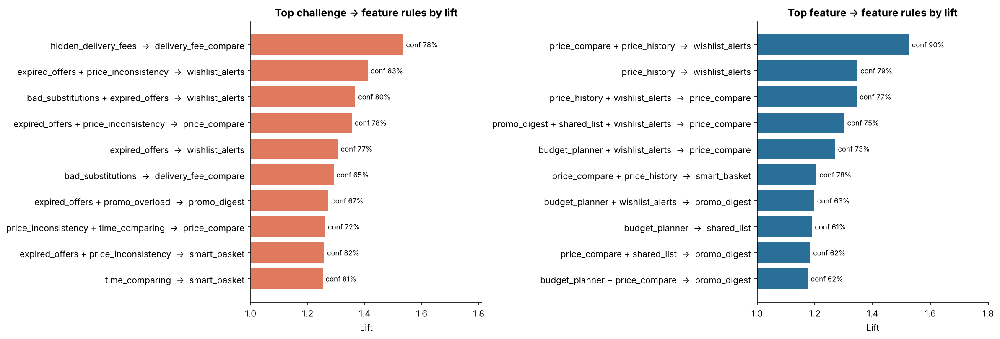

### 7.4 How many features at launch?

Features were added greedily, each time choosing the one that leaves the most adopters *well served* (the MVP includes at least two of the features they ticked).

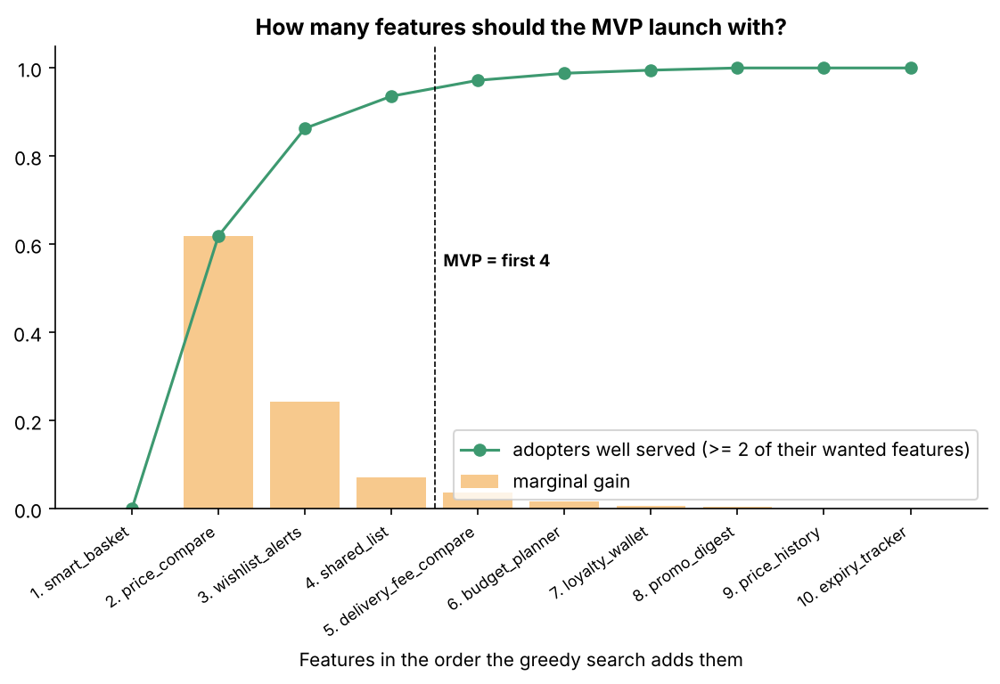

| Features in MVP | Adopters well served | Gain |
|---|---|---|
| smart basket + price compare | 62% | — |
| + wishlist alerts | 86% | +24 pts |
| **+ shared list** | **94%** | +7 pts |
| + delivery-fee compare | 97% | +4 pts |
| + budget planner | 99% | +2 pts |

**Decision: launch with four features** — smart basket, price compare, wishlist alerts and shared list — which serve 94% of adopters. The fifth adds under 5 points. Delivery-fee comparison and price history are kept for **Premium** (see Section 8), and per the rules above, price history ships together with wishlist alerts.

---

## 8. Regression — how much will people pay?

**Why regression?** The finance question is "how much", a continuous number. Regression estimates willingness to pay (WTP) from customer traits and wanted features, shows which features raise it, and feeds the pricing decision.

**Setup.** Target `wtp_aed_month` (Q20), 1,786 respondents with an answer. Mean AED 6.1, median AED 5, and 30% would pay nothing. Same pre-pitch inputs as classification; intent, NPS and plan excluded (leakage).

### 8.1 Model comparison

| Model | CV R² (5-fold) | Test R² | Test MAE (AED) | Test RMSE |
|---|---|---|---|---|
| **Random Forest** | **0.402 ± 0.051** | 0.441 | 2.99 | 4.28 |
| Lasso | 0.387 ± 0.056 | 0.470 | 2.83 | 4.17 |
| Ridge | 0.378 ± 0.057 | 0.475 | 2.79 | 4.15 |
| Gradient Boosting | 0.378 ± 0.070 | 0.416 | 2.98 | 4.37 |
| Linear Regression (OLS) | 0.375 ± 0.055 | 0.467 | 2.80 | 4.18 |
| *Baseline: predict the mean* | 0 | −0.01 | 4.67 | 5.76 |

All models explain around 40–47% of the variation and cut the average error by about a third compared with guessing the mean. That is typical for stated-preference survey data, where much of the variation is personal. Random Forest was selected on CV R²; the linear models do equally well on the test set, which suggests the relationships are mostly linear.

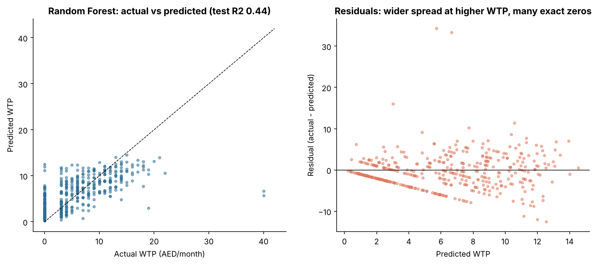

The residual plot shows two weaknesses: the many exact zeros (people who will never pay) and wider errors for high payers. A two-part model (first "will pay at all?", then "how much?") is a sensible next step with real data.

### 8.2 What drives willingness to pay

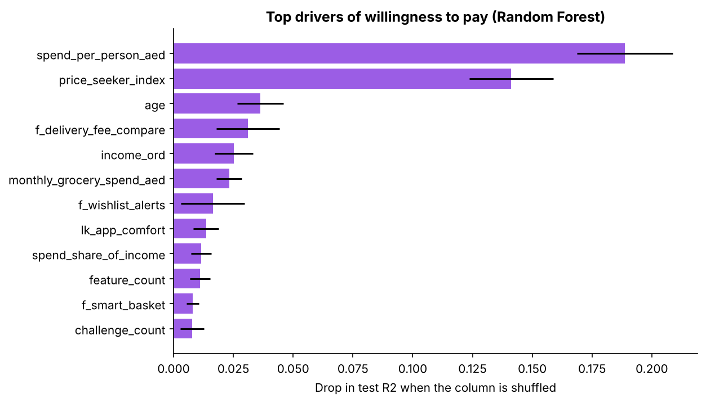

Ridge coefficients, used for direction because the composite `price_seeker_index` makes plain OLS coefficients unstable (it is an exact combination of three Likert items):

| Driver | Effect on WTP |
|---|---|
| Each higher income band | +AED 1.40 |
| Being a student | −AED 2.74 |
| Wants **delivery-fee comparison** | **+AED 1.62** |
| Wants smart basket | +AED 1.37 |
| Wants wishlist alerts | +AED 1.14 |
| Wants price history | +AED 1.02 |
| Wants budget planner | −AED 0.78 |

### 8.3 Decision: price and paywall

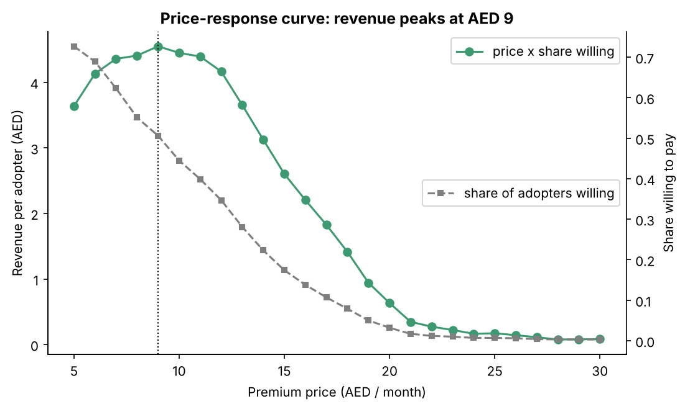

Among likely adopters (mean WTP AED 8.7), revenue per adopter — price × share still willing — peaks at **AED 9/month**, where 51% of adopters say they would pay. The curve is flat between AED 7 and AED 11, so AED 9 is a safe middle.

- **Premium = AED 9/month**, with a lower annual price to reduce churn.
- **Behind the paywall:** delivery-fee comparison and price history, the two features that raise WTP most and are *not* needed to serve 94% of adopters in the free MVP.
- **Free tier:** smart basket, price compare, wishlist alerts (limited list size) and shared list.

Stated WTP usually overstates real payment, so the business case assumes only 2–6% of active users actually subscribe, far below the 51% who say they would.

---

## 9. Integrated strategy

### 9.1 Marketing
| | Phase 1 (months 0–6) | Phase 2 (6–12) | Phase 3 (12–24) |
|---|---|---|---|
| Segments | Deal Hunters | + Budget Families, Students | + Busy Professionals |
| Message | "Your whole basket, cheapest store, no spam" | "Save AED 150 a month as a family" / "Split the list, split the bill" | "See the true total across delivery apps" |
| Channels | Deal communities, WhatsApp groups, referral codes | School and community groups, university societies | Paid social targeted with the lead-score profile |
| Budget rule | High lead-tier only | High + nurture Medium | Measured CAC by segment |

### 9.2 Product
- **MVP (free):** smart basket, price compare, wishlist alerts, shared list.
- **Premium (AED 9):** delivery-fee comparison, price history with "is this a real deal?" signal, unlimited wishlist.
- **Notification rule:** default to "only big savings on my list" (47% prefer it), with weekly digest as the option.
- **Not now:** loyalty wallet and expiry tracker (wanted mostly by non-adopters).

### 9.3 Operations and supply chain (data supply)
For a price app, the "supply chain" is the price data itself.
- **Coverage first:** Dubai, Abu Dhabi and Sharjah hold 83% of respondents, so launch with full store coverage there before the northern emirates.
- **Data sources:** formal data partnerships with retailers are preferred over scraping, which carries terms-of-service and reliability risks. Crowd-sourced receipt scanning is a backup: 42% of respondents would share receipts for rewards.
- **Product matching:** the hardest technical task is matching the same product across stores (sizes, brands, multipacks). Barcode (GTIN) matching should be built before scaling.
- **Freshness:** "expired offers" is a core pain, so prices shown must be updated at least daily or the app recreates the problem it solves.

### 9.4 Finance — is it sustainable?

`src/business_case.py` combines the model outputs with clearly labelled planning assumptions (downloads, active rate, conversion, ad and partner revenue, team, data and acquisition costs).

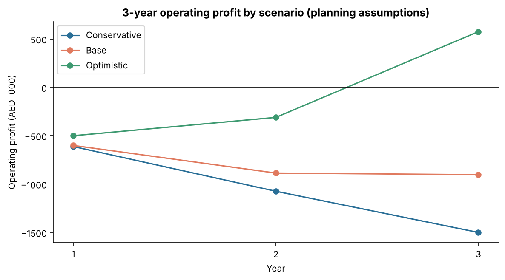

| Scenario | Year 3 active users | Premium subs | Revenue | Cost | Operating profit |
|---|---|---|---|---|---|
| Conservative | 68,250 | 1,365 | AED 0.61M | AED 2.11M | −AED 1.50M |
| Base | 136,500 | 5,460 | AED 1.87M | AED 2.77M | −AED 0.90M |
| Optimistic | 224,000 | 13,440 | AED 4.13M | AED 3.55M | **+AED 0.58M** |

In the base case, Premium is only 27% of Year-3 revenue; ads are 34% and retailer partnerships 39%.

**The honest answer is that Premium subscriptions alone do not make this sustainable.** The sensitivity analysis shows what does:

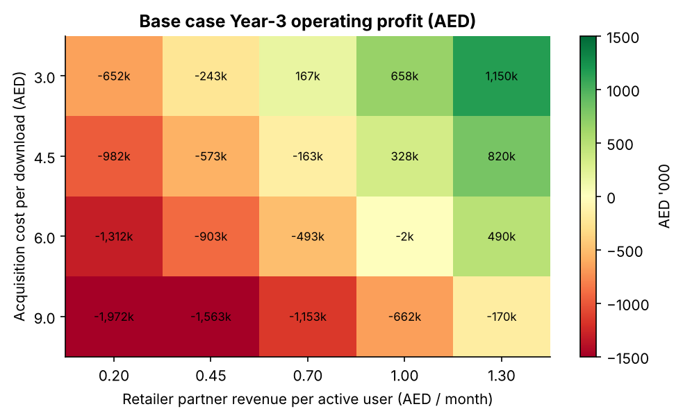

The base case breaks even in Year 3 if retailer partnerships earn about **AED 1.00 per active user per month** at the assumed AED 6 acquisition cost, or somewhere between AED 0.45 and 0.70 if acquisition cost is halved to AED 3 through referrals. The two levers that decide viability are therefore **cheap acquisition** (referral-led growth among Deal Hunters) and **retailer partnerships** (sponsored deals, click-and-collect referrals, anonymised price insights).

**Go / no-go recommendation:** proceed to a real survey and a 3-month pilot in Dubai, with two kill criteria set in advance — acquisition cost per download above AED 6, or no retailer willing to sign a partnership term sheet by month 6.

---

## 10. Limitations

1. **Synthetic data.** The relationships were designed in; real data will be noisier and may disagree.
2. **Stated vs real behaviour.** "Yes" and WTP answers overstate real downloads and payments. The business case discounts them heavily.
3. **Survey sample.** A real panel will over-represent people who like surveys and apps. Weighting by emirate, nationality and income against official statistics would be needed.
4. **Imputation before splitting.** Medians were computed on the full sample before the train/test split. The leakage is minimal with these simple statistics, but a production pipeline should fit them on training data only.
5. **Business-case inputs.** Costs, conversion, ad and partner rates are placeholders, not quotes. Retailer names describe the comparison concept; no affiliation or data agreement exists.

## 11. How to reuse this with a real survey

1. Run the survey in `survey/survey_questionnaire.md` and export it with the same column names.
2. Save the export as `data/raw/basketwise_survey_raw.csv`.
3. Run `python run_pipeline.py` (without `--regenerate`). The clustering validation against hidden personas is skipped automatically if no answer key exists.
4. Compare the new `outputs/results_summary.json` with this report to see what changed.

---

### Appendix — reproducibility
- Random seed 42 everywhere; the full pipeline runs in about a minute.
- Every number in this report is in `outputs/results_summary.json` or `outputs/tables/`.
- Code: `src/` (one script per step), entry point `run_pipeline.py`.
